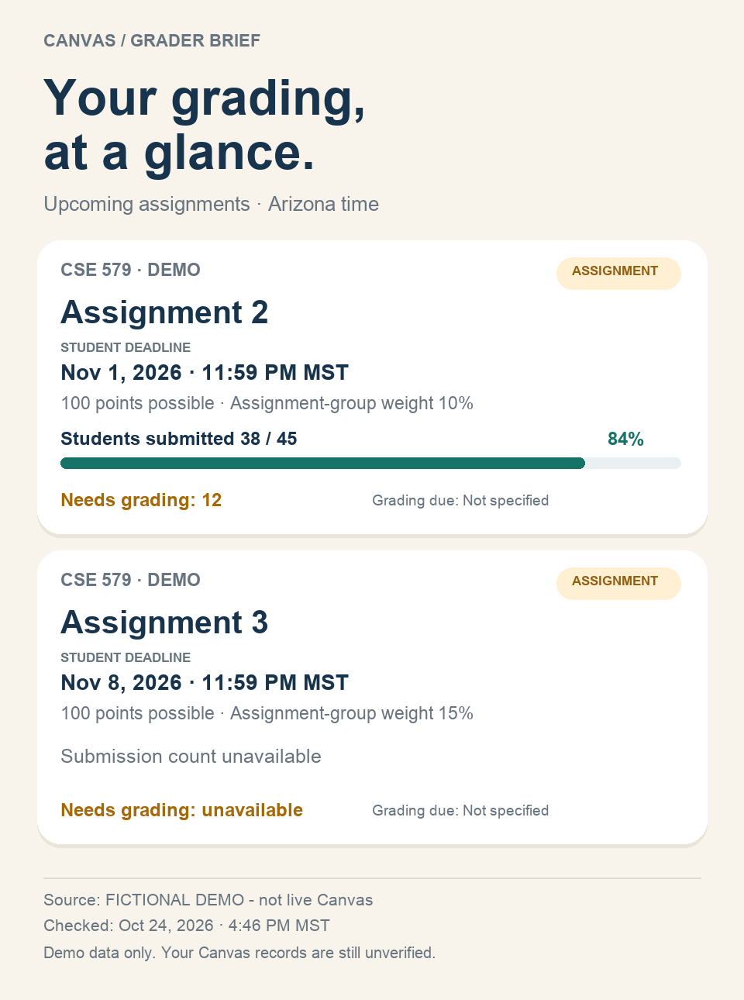

# Canvas Grader Brief

A Cubbie Skill for students who also serve as Canvas TAs, graders, or instructional assistants. Ask for Canvas To Do tasks, course assignments, deadlines, submission counts, or pending grading work.

## Canvas To Do

Ask: "Read my Canvas To Do for the courses I TA. Explain the deadlines and what needs grading."

The Skill separates grading work from personal submission tasks, labels student submission deadlines separately from explicit grading deadlines, and cross-checks assignments for a requested date. Canvas To Do is a limited list, so it does not replace the full assignment calendar. It never dismisses tasks. Connected To Do access is unverified; the Skill offers a secure browser route or a supplied snapshot when necessary.

## Visual iMessage cards

The Skill now generates PNG image cards showing upcoming assignment names, student deadlines, points possible, and verified grading counts. Submission bars appear only with a matching verified student denominator. Missing data stays labeled unavailable. Student submission deadlines and grading deadlines remain separate. This is an image attachment; custom interactive iMessage cards are not assumed.

The Python renderer needs Python 3.10+ and Pillow==12.0.0. Setup and commands are in SKILL.md; the schema is in references/card-format.md. The renderer works offline and never accesses Canvas credentials. Its sample data is explicitly fictional. Live PNG delivery through Cubbie still needs testing.

Fictional preview (not real Canvas data):

## Large attachments and partial sync

For deadline and grading briefs, the Skill prioritizes assignment metadata and avoids bulk attachment processing. If a requested file exceeds the observed 52,428,800-byte (50 MiB) upload limit, it skips that file in its own workflow, reports the omission, and continues accessible assignment and To Do data. Unknown sizes are reported rather than guessed. It never deletes or modifies Canvas files.

This does **not** change Cubbie's automatic sync service, prevent that service from retrying files, or clear its partial-sync status. The observed limit comes from the user's service error; current service responses take precedence. Live behavior is still untested.

## Status

First draft. Live staff access and submission statistics have **not** been tested on Cubbie. The installed kit documents courses, assignments, and deadlines, but does not guarantee staff statistics through its Canvas connection. The Skill tries that connection first and offers an authenticated Canvas browser workflow if necessary. It reports unavailable counts honestly.

This version reads workload information. It does not evaluate submissions or write grades.

## Requirements

- Cubbie access for live testing.
- Your own Canvas account with permission to view the relevant course and submission statistics.
- A connected Canvas account, or access to the school's Canvas site through Cubbie's browser.

No API keys are needed for the renderer; Pillow is installed in a private virtual environment. Outside Cubbie, an agent can summarize an authorized export as a snapshot and render the same card.

## Try it after publishing

Text Cubbie this Skill folder link, approve installation, then send a new message:

https://github.com/Mahima-Bhat15/Fourth-Dimension/tree/main/canvas-grader-brief

> For the courses where I'm a TA, show assignments due this week, deadlines, and how many students submitted.

Confirm the course, section, deadline variants, and counts against Canvas. Test missing permissions and group assignments too. Installation and live tests are still pending.
