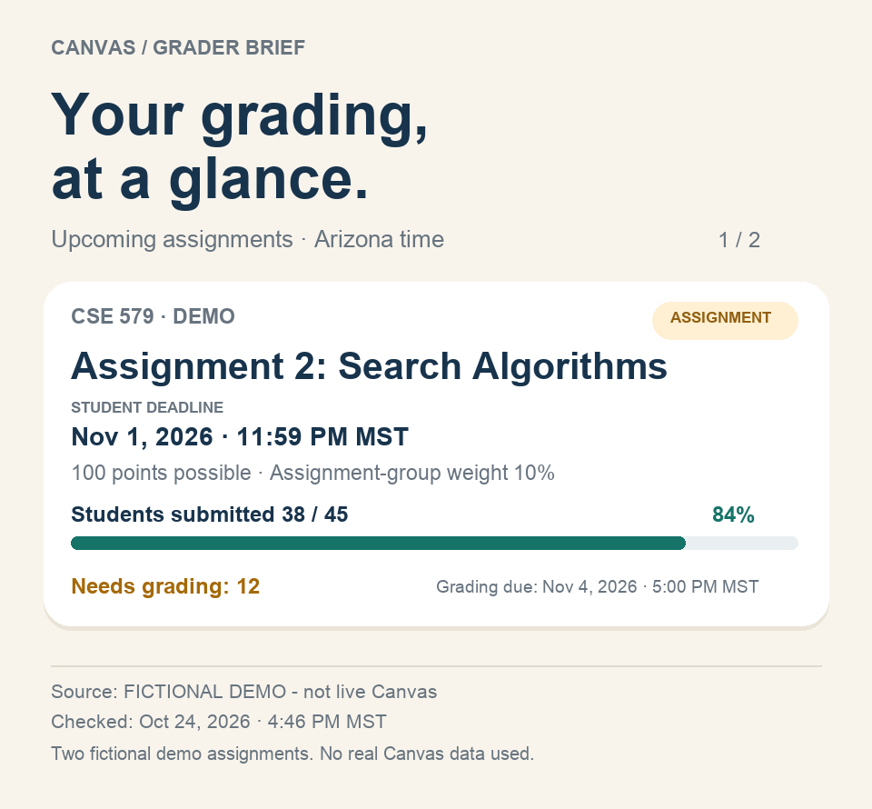

# Cubboard

Formerly installed as `canvas-grader-brief`. Install from the new folder link below; after Cubboard installs successfully, remove the older Skill to avoid duplicate triggers. Existing private configuration and renderer environment paths retain their original names for compatibility. The card design and workflows are unchanged.

A Cubbie Skill for students who also serve as Canvas TAs, graders, or instructional assistants. Ask for Canvas To Do tasks, course assignments, deadlines, submission counts, or pending grading work.

## Google Calendar reminders

Say "Remind me to grade Assignment 2 tomorrow at 9 am Arizona time." The Skill resolves the assignment and time, uses your connected Google Calendar, and creates a personal event with a notification at the reminder time. Missing times or ambiguous assignments are clarified first, repeated requests are checked for duplicates, and success is confirmed only after reading the event back. Your Google Calendar connection is separate from Canvas and hackathon sign-in. See references/calendar-reminders.md. Live Calendar creation still needs testing on Cubbie.

## Canvas To Do

Ask: "Read my Canvas To Do for the courses I TA. Explain the deadlines and what needs grading."

The Skill separates grading work from personal submission tasks, labels student submission deadlines separately from explicit grading deadlines, and cross-checks assignments for a requested date. Canvas To Do is a limited list, so it does not replace the full assignment calendar. It never dismisses tasks. Connected To Do access is unverified; the Skill offers a secure browser route or a supplied snapshot when necessary.

## Visual iMessage cards

The original full card design is restored, including "Your grading, at a glance", deadline/points fields, progress bars, and source/check-time footer. For exactly two fictional demo entries, ask Cubbie: "Show the two bundled fictional grader demo cards." It should run `scripts/render_card.py --demo` in the configured environment and attach both resulting PNG images, one card per assignment. Demo output is labeled fictional and kept separate from real Canvas reports.

The Skill generates one standalone PNG card per assignment showing upcoming assignment names, student deadlines, points possible, and verified grading counts. Submission bars appear only with a matching verified student denominator. Missing data stays labeled unavailable. Student submission deadlines and grading deadlines remain separate. This is an image attachment; custom interactive iMessage cards are not assumed.

The Python renderer needs Python 3.10+ and Pillow==12.0.0. Setup and commands are in SKILL.md; the schema is in references/card-format.md. The renderer works offline and never accesses Canvas credentials. Its sample data is explicitly fictional. Live PNG delivery through Cubbie still needs testing.

Fictional preview (not real Canvas data):

## Large attachments and partial sync

For deadline and grading briefs, the Skill prioritizes assignment metadata and avoids bulk attachment processing. If a requested file exceeds the observed 52,428,800-byte (50 MiB) upload limit, it skips that file in its own workflow, reports the omission, and continues accessible assignment and To Do data. Unknown sizes are reported rather than guessed. It never deletes or modifies Canvas files.

This does **not** change Cubbie's automatic sync service, prevent that service from retrying files, or clear its partial-sync status. The observed limit comes from the user's service error; current service responses take precedence. Live behavior is still untested.

## Status

First draft. Live staff access and submission statistics have **not** been tested on Cubbie. The installed kit documents courses, assignments, and deadlines, but does not guarantee staff statistics through its Canvas connection. The Skill tries that connection first and offers an authenticated Canvas browser workflow if necessary. It reports unavailable counts honestly.

This version reads workload information. It does not evaluate submissions or write grades.

## Requirements

- Cubbie access for live testing.
- Your own Canvas account with permission to view the relevant course and submission statistics.
- A connected Canvas account, or access to the school's Canvas site through Cubbie's browser.

No API keys are needed for the renderer; Pillow is installed in a private virtual environment. Outside Cubbie, an agent can summarize an authorized export as a snapshot and render the same card.

# Cubbridge — Career Applications, Networking, and Assessments
You applied. Now what?

Cubbridge is a career-focused Cubbie Skill that turns authorized Gmail application updates into clear next steps: which roles you applied for, what assessments are coming up, and which verified recruiters or alumni might be worth contacting. It is designed for short, useful iMessage responses; Cubboard is the planned place for deeper application histories, contact lists, and drafts.
What Cubbridge does
Feature	What you can ask	What you get
Application tracking	“Cubbridge, check my applications from the last 90 days.”	Role-by-role application records based on authorized Gmail evidence
Recruiter and alumni discovery	“Find recruiters or alumni at Microsoft.”	Up to three verified individual LinkedIn profiles, when available
Personalized networking	“Draft a LinkedIn note for these contacts.”	Short, ready-to-review messages grounded in verified information
Assessment tracking	“What assessments are due this week?”	Confirmed upcoming deadlines, with ambiguous dates clearly flagged
Calendar support	“Add this assessment deadline to Google Calendar.”	An approval-based event workflow or a prefilled link, as appropriate
Excel export	“Export my career tracker to Excel.”	An optional three-sheet .xlsx workbook

## How it works
1. Check applications. With the student's permission, Cubbie searches connected Gmail for application confirmations, recruiter replies, assessments, interviews, offers, and rejections. Cubbridge groups messages by company, role, and requisition when available. Different roles at the same company stay separate.
2. Reconcile hiring status. Confirmed rejections are omitted from default active/non-rejected briefings only for the matching application. A missing email or partial search is never treated as proof of a particular status. Actual application dates are distinguished from confirmation-email dates.
3. Find relevant people. For a requested company, Cubbridge uses permitted public profile research and authorized contact information to identify current recruiters, verified alumni, or confirmed existing connections. It returns two or three real individual profiles when it can verify them; otherwise it reports the gap.
4. Prepare outreach. It drafts one short, personalized LinkedIn note per verified person (aiming for 200 characters or fewer). Confirmed first-degree connections receive a direct-message draft; everyone else receives a connection-request note. The student reviews and sends LinkedIn messages manually.
5. Keep deadlines visible. Assessment invitations and interviews are tracked separately. A Calendar link is offered only for a verified future deadline when explicitly requested. Direct event creation requires the student's approval and verification of the saved event.
Example Cubbie conversations
Daily career briefing
Cubbridge, what should I do today?

Cubbridge returns a compact iMessage summary of tracked non-rejected applications, confirmed upcoming assessments and interviews, and at most two urgent actions. It does not flood the conversation with full application histories or contact lists.

Networking at a specific company
Cubbridge, find two or three recruiters or alumni at Adobe and draft connection notes.

Each verified match includes an individual LinkedIn profile link, a supported relationship label, and one short draft. Cubbridge does not invent people, connection status, or profile URLs.

Assessment planning
Cubbridge, show my upcoming assessments and help me add one to Google Calendar.

It distinguishes confirmed dates from deadlines that need clarification. A prefilled Google Calendar link does not mean an event has been saved.

Optional workbook
Cubbridge, export my applications, LinkedIn contacts, and assessments to Excel.

## The requested workbook has three sheets:
Sheet	Columns
Applications	Company name · Role applied · Date applied
LinkedIn Connections	Company name · Contact name · LinkedIn profile link · Short outreach message
Assessments	Company name · Assessment · Deadline (local time and time zone) · Add to Google Calendar link

Unknown application dates, missing LinkedIn links, and uncertain deadlines are labeled rather than guessed. Excel is not generated for ordinary briefings.
Privacy and permissions
- Gmail: Reads only within the student's authorized scope; disconnected accounts can be replaced with student-supplied hiring messages for a labeled snapshot.
- LinkedIn: Does not claim direct LinkedIn API access, private connection-graph access, scraping, or automatic LinkedIn messaging. Existing first-degree connections are identified only from authorized evidence. Public profiles alone do not prove a connection.
- Outreach: Email recipients, subject, body, and attachments must be shown and explicitly approved before sending. Drafting never counts as sending.
- Calendar: Direct event creation requires approval; a successful write is reported only after verifying the event and reminder settings. Duplicate checks are part of the workflow.
- Local data: The private application ledger is stored at ~/.config/cubbridge/pipeline.sqlite3; requested reports are stored at ~/.config/cubbridge/reports/. The Skill does not require a separate backend or API key and does not send private email, resumes, or contacts to a team backend.
## Requirements
- Access to Cubbie for installation and live testing.
- Connected Gmail or student-provided application emails for a non-live snapshot.
- Permitted Cubbie web/browser research for verified public professional profiles.
- School information for alumni matching, when not already verified.
- Optional connected Google Contacts and Google Calendar for richer results.
- Python 3 to run the bundled local pipeline script.
Install and try Cubbridge
Publish the Cubbridge Skill folder to GitHub, then send its actual folder URL to Cubbie and approve installation. No Cubbridge publication link is assumed until the folder is confirmed live.

Try:
Cubbridge, check my recent job applications and tell me what needs attention.

Or:
Cubbridge, find verified recruiters or alumni at Microsoft and draft LinkedIn connection notes.

## How the Skills fit together
Product	Role
Cubbie	Conversational assistant that invokes the relevant Skill
Canvas Grader Brief	Canvas assignments, TA grading workload, and reminders
Cubbridge	Applications, professional networking, assessments, and career outreach drafts
Cubboard	Planned dashboard for detailed information, when available

The Skills remain independent. Canvas access does not grant Gmail or LinkedIn permissions, and career workflows do not modify grades or Canvas submissions.

## Try it after publishing

Text Cubbie this Skill folder link, approve installation, then send a new message:

https://github.com/Mahima-Bhat15/Fourth-Dimension/tree/main/cubboard

> For the courses where I'm a TA, show assignments due this week, deadlines, and how many students submitted.

Confirm the course, section, deadline variants, and counts against Canvas. Test missing permissions and group assignments too. Installation and live tests are still pending.
